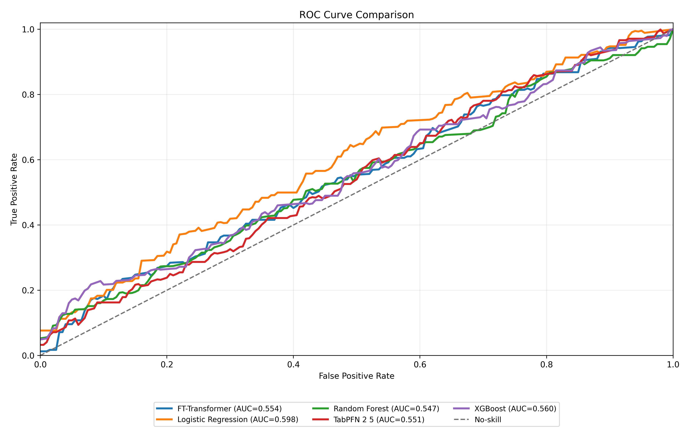
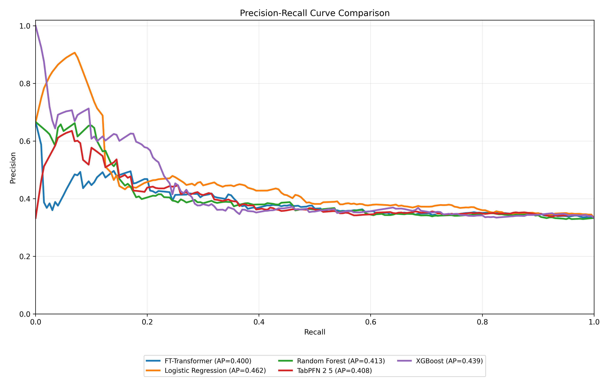
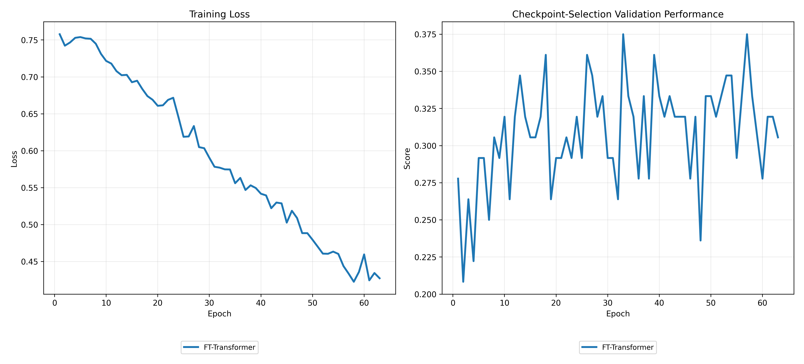
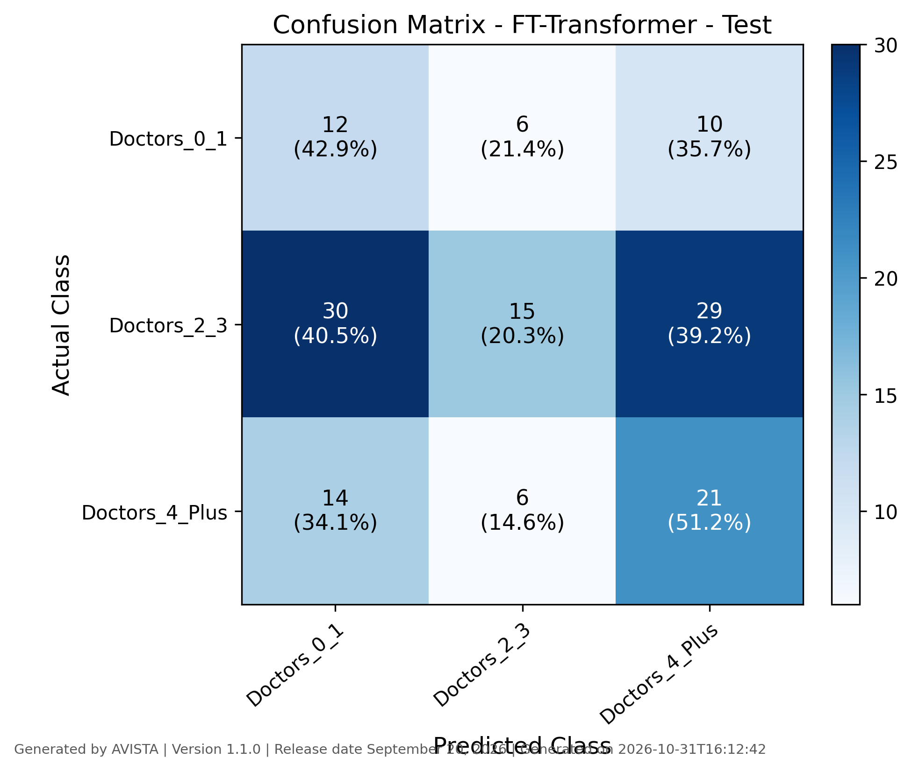
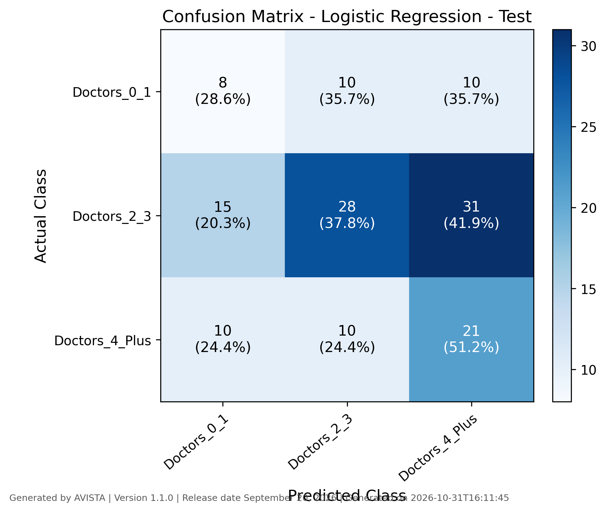
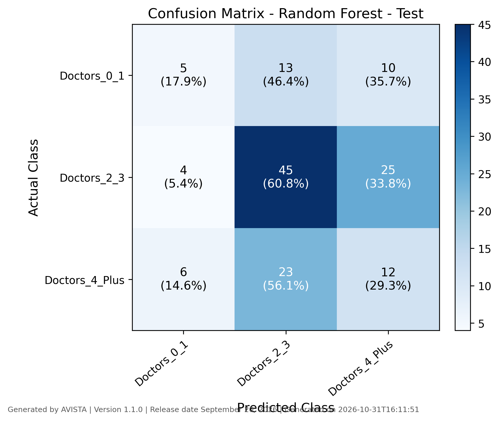
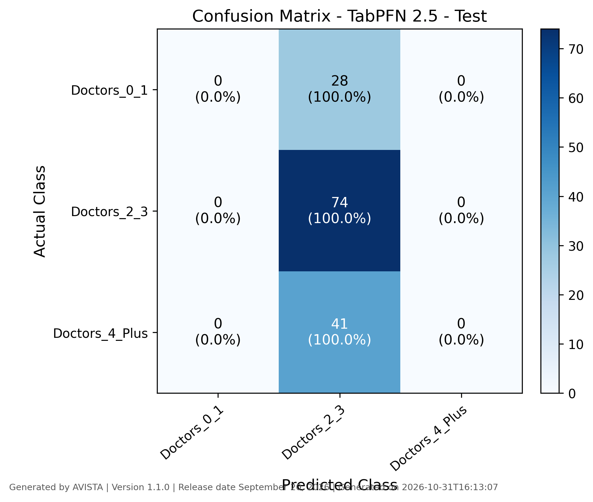
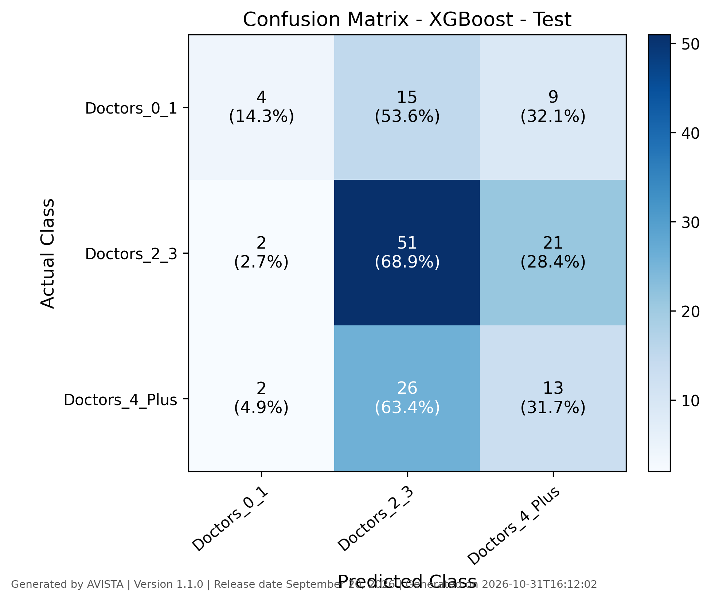
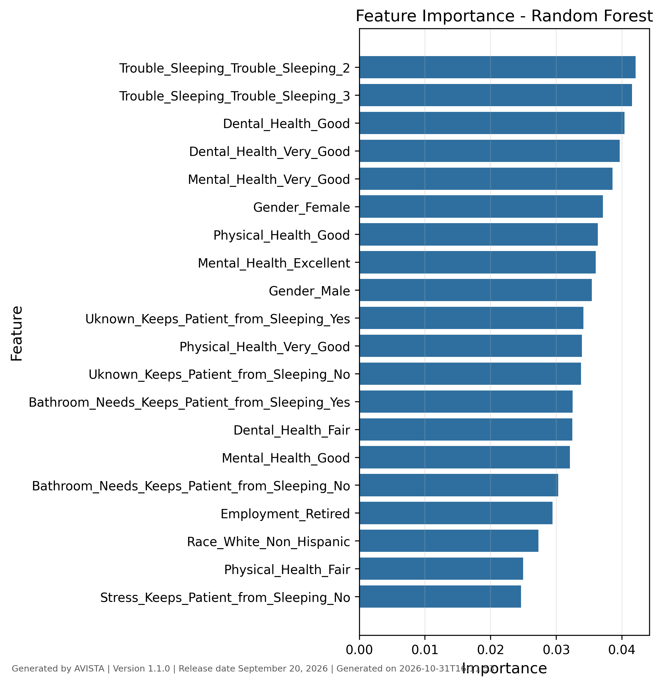

# AVISTA Model Report

An extensible desktop platform for tabular machine learning and deep learning analytics.

## Project Summary

- Project name: national-poll2
- Target column: Number_of_Doctors_Visited
- Report generated: 2026-10-31T16:13:44
- AVISTA version: 1.1.0
- AVISTA release date: September 20, 2026

## Dataset Summary

- Original dataset rows: 714
- Feature count: 13
- Training rows: 499
- Effective training rows: 541
- Validation rows: 72
- Test rows: 143

## Modeling Configuration

- Selected models: logistic_regression, random_forest, xgboost, ft_transformer, tabpfn
- Cross-validation: Enabled
- CV folds: 5

## Split and Imbalance Summary

- Split method: random
- Imbalance method: smote
- Numerical scaling: none
- Validation role: deep-model early stopping and checkpoint selection
- Test role: held-out final evaluation after fitting and checkpoint selection
- CV role: outer validation folds are used only for fold scoring

## TabPFN 2.5 Input Protocol

- Python package version: 8.0.8
- Checkpoint/model version: 2.5
- Input representation: raw_dataframe
- External preprocessing applied: No
- External resampling applied: No
- Available external-training rows: 499
- Effective training rows: 499
- Supported row limit: 50000
- Subsampling applied: No
- Subsampling strategy: none
- Random seed: 42
- Input features: 13
- Target classes: 3

## Model Performance Summary

Unless otherwise stated, model comparison figures and diagnostic tables are based on the test set.

| Model | Status | Train Accuracy | Train Macro-F1 | Validation Accuracy | Validation Macro-F1 | Test Accuracy | Test Macro-F1 | CV Accuracy Mean | CV Accuracy Std | CV Macro-F1 Mean | CV Macro-F1 Std | ROC-AUC | Saved |
| --- | --- | --- | --- | --- | --- | --- | --- | --- | --- | --- | --- | --- | --- |
| Logistic Regression | trained | 0.5176 | 0.5168 | 0.3611 | 0.3677 | 0.3986 | 0.3764 | 0.3747 | 0.0412 | 0.3633 | 0.0411 | 0.6002 | Yes |
| Random Forest | trained | 0.9501 | 0.9464 | 0.4028 | 0.3372 | 0.4336 | 0.3620 | 0.3747 | 0.0391 | 0.3057 | 0.0253 | 0.5456 | Yes |
| XGBoost | trained | 0.9057 | 0.8994 | 0.4167 | 0.2817 | 0.4755 | 0.3821 | 0.4128 | 0.0326 | 0.3065 | 0.0237 | 0.5589 | Yes |
| FT-Transformer | trained | 0.4954 | 0.4960 | 0.3750 | 0.3722 | 0.3357 | 0.3329 | 0.3367 | 0.0232 | 0.3192 | 0.0216 | 0.5536 | Yes |
| TabPFN 2.5 | trained | Not available | Not available | 0.5278 | 0.2303 | 0.5175 | 0.2273 | 0.5211 | 0.0021 | 0.2284 | 0.0006 | 0.5483 | Yes |

## ROC Curve Comparison

## Precision-Recall Curve Comparison

## Deep Learning Training Curves

## Confusion Matrices

### FT-Transformer

### Logistic Regression

### Random Forest

### TabPFN 2 5

### XGBoost

## Classification Reports

### FT-Transformer - Test

| Class | precision | recall | f1-score | support |
| --- | --- | --- | --- | --- |
| Doctors_0_1 | 0.2143 | 0.4286 | 0.2857 | 28.0000 |
| Doctors_2_3 | 0.5556 | 0.2027 | 0.2970 | 74.0000 |
| Doctors_4_Plus | 0.3500 | 0.5122 | 0.4158 | 41.0000 |
| accuracy | 0.3357 | 0.3357 | 0.3357 | 0.3357 |
| macro avg | 0.3733 | 0.3812 | 0.3329 | 143.0000 |
| weighted avg | 0.4298 | 0.3357 | 0.3289 | 143.0000 |

### Logistic Regression - Test

| Class | precision | recall | f1-score | support |
| --- | --- | --- | --- | --- |
| Doctors_0_1 | 0.2424 | 0.2857 | 0.2623 | 28.0000 |
| Doctors_2_3 | 0.5833 | 0.3784 | 0.4590 | 74.0000 |
| Doctors_4_Plus | 0.3387 | 0.5122 | 0.4078 | 41.0000 |
| accuracy | 0.3986 | 0.3986 | 0.3986 | 0.3986 |
| macro avg | 0.3882 | 0.3921 | 0.3764 | 143.0000 |
| weighted avg | 0.4464 | 0.3986 | 0.4058 | 143.0000 |

### Random Forest - Test

| Class | precision | recall | f1-score | support |
| --- | --- | --- | --- | --- |
| Doctors_0_1 | 0.3333 | 0.1786 | 0.2326 | 28.0000 |
| Doctors_2_3 | 0.5556 | 0.6081 | 0.5806 | 74.0000 |
| Doctors_4_Plus | 0.2553 | 0.2927 | 0.2727 | 41.0000 |
| accuracy | 0.4336 | 0.4336 | 0.4336 | 0.4336 |
| macro avg | 0.3814 | 0.3598 | 0.3620 | 143.0000 |
| weighted avg | 0.4260 | 0.4336 | 0.4242 | 143.0000 |

### TabPFN 2 5 - Test

| Class | precision | recall | f1-score | support |
| --- | --- | --- | --- | --- |
| Doctors_0_1 | 0.0000 | 0.0000 | 0.0000 | 28.0000 |
| Doctors_2_3 | 0.5175 | 1.0000 | 0.6820 | 74.0000 |
| Doctors_4_Plus | 0.0000 | 0.0000 | 0.0000 | 41.0000 |
| accuracy | 0.5175 | 0.5175 | 0.5175 | 0.5175 |
| macro avg | 0.1725 | 0.3333 | 0.2273 | 143.0000 |
| weighted avg | 0.2678 | 0.5175 | 0.3529 | 143.0000 |

### XGBoost - Test

| Class | precision | recall | f1-score | support |
| --- | --- | --- | --- | --- |
| Doctors_0_1 | 0.5000 | 0.1429 | 0.2222 | 28.0000 |
| Doctors_2_3 | 0.5543 | 0.6892 | 0.6145 | 74.0000 |
| Doctors_4_Plus | 0.3023 | 0.3171 | 0.3095 | 41.0000 |
| accuracy | 0.4755 | 0.4755 | 0.4755 | 0.4755 |
| macro avg | 0.4522 | 0.3830 | 0.3821 | 143.0000 |
| weighted avg | 0.4714 | 0.4755 | 0.4502 | 143.0000 |

## Feature Importance

### Random Forest

## Output Files

- model_performance_summary.csv
- roc_curve_comparison.png
- pr_curve_comparison.png
- deep_training_curves.png
- model_performance_summary.csv
- AVISTA_Report.md
- AVISTA_Report.pdf

## Reproducibility Metadata

- Project file: D:\TXST\OneDrive - Texas State University\Hackathon_Monzurul\Papers\AVISTA\examples\national-poll2\national-poll2.avista
- Random state: 42
- Target column: Number_of_Doctors_Visited

---

Generated by AVISTA
Version 1.1.0
Generated on 2026-10-31T16:13:44
